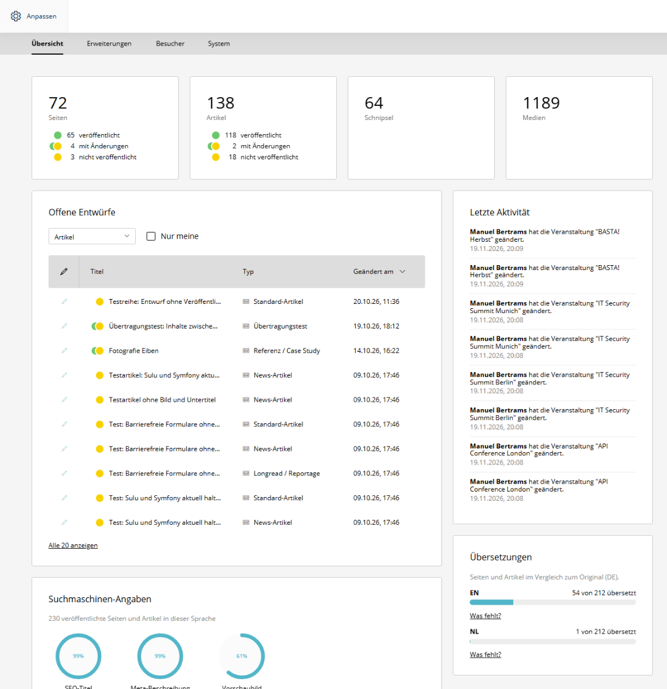
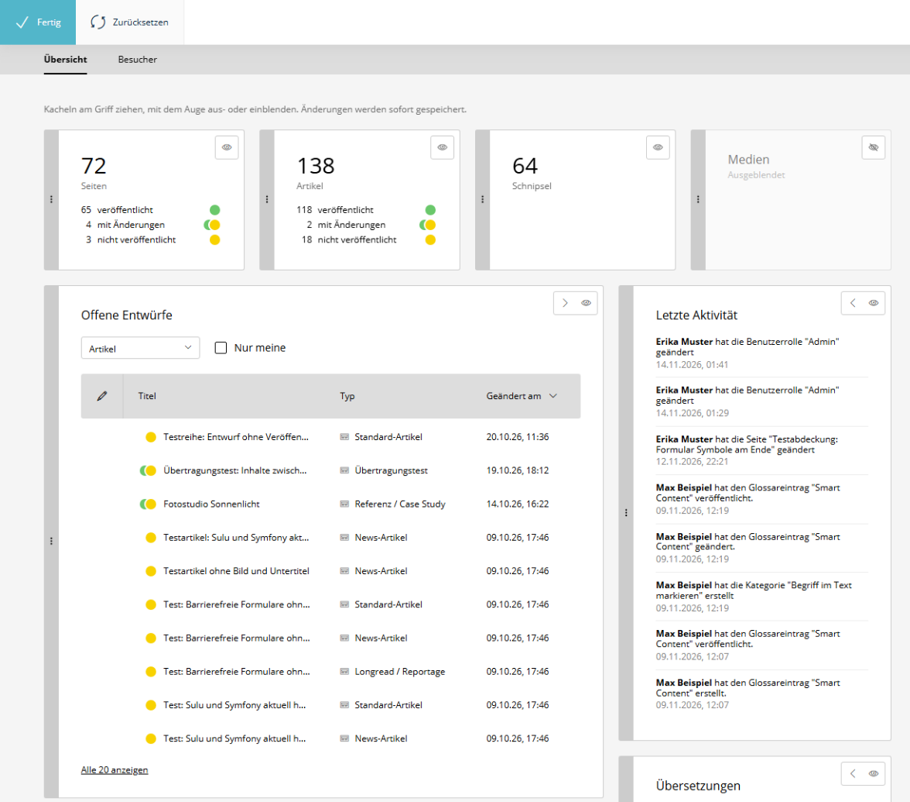

# SuluDashboardBundle!

[](https://github.com/manuxi/SuluDashboardBundle/blob/main/LICENSE)


[🇬🇧 English Version](README.md)

Das SuluDashboardBundle gibt dem Sulu-3-Admin eine Startseite. Statt einer leeren Fläche sehen Redakteure, was noch zu tun ist (offene Entwürfe), was zuletzt passiert ist, wie vollständig die Übersetzungen sind und wie viele Inhalte es gibt.

Die Seite besteht nur aus den Bausteinen von Sulu (Toolbar mit Sprachauswahl, Raster, Karten, Tabellen, Veröffentlichungs-Punkt). Andere Bundles und Projekte ergänzen eigene Kacheln mit einer kleinen PHP-Klasse, ohne JavaScript.



Jeder Benutzer kann die Kacheln nach seinem Geschmack anordnen. Im Anpassen-Modus lassen sich Kacheln verschieben, ausblenden oder auf den Standard zurücksetzen:



## ✨ Funktionen

- **Offene Entwürfe** - Seiten und Artikel, die nicht so live sind, wie sie bearbeitet wurden; sortierbar, Filter nach Typ und „Nur meine“, Stift-Button zum Formular
- **Zahlen** - Seiten, Artikel, Schnipsel und Medien, aufgeteilt nach Status mit Sulus Veröffentlichungs-Punkt
- **Übersetzungen** - Fehlende und veraltete Übersetzungen je Sprache, mit Liste dessen, was fehlt
- **Letzte Aktivität** - Aus Sulus Aktivitäts-API
- **Anpassen** - Jeder Benutzer kann Kacheln anordnen, ausblenden und zurücksetzen; bis dahin gleichen sich die Spalten selbst aus
- **Rechte** - Eigenes Recht für das Dashboard; jede Kachel beachtet die Rechte der Inhalte und ihren eigenen Sicherheitskontext
- **Kachel-Schnittstelle** - `DashboardWidgetInterface`, Darstellungsarten `number`, `progress`, `list`, `bars`, `chart` (Linien- und Balkendiagramme in SVG) und `custom` (eigene React-Komponente)
- **Tabs** - Bundles können eine ganze Seite als Tab ergänzen (`DashboardTabProviderInterface`); mit `amoifr/sulu-log-stats-bundle` bekommt das Dashboard den Tab „Besucher“ und eine Kachel. Die Besucherstatistik stammt aus dem Bundle [amoifr/sulu-log-stats-bundle](https://github.com/Amoifr/sulu-log-stats-bundle) von Amoifr. Danke für ein so schlankes und datensparsames Bundle.
- **Fehler bleiben in ihrer Kachel** - Jede Kachel lädt ihre Daten einzeln

## 📋 Voraussetzungen

- PHP 8.2 oder höher
- Sulu CMS 3.0 oder höher
- Symfony 6.4 oder höher

## 👩🏻‍🏭 Installation

### Schritt 1: Paket installieren

```bash
composer require manuxi/sulu-dashboard-bundle
```

Ohne Symfony Flex das Bundle in `config/bundles.php` eintragen:

```php
return [
    //...
    Manuxi\SuluDashboardBundle\SuluDashboardBundle::class => ['all' => true],
];
```

### Schritt 2: Routen

In `config/routes_admin.yaml` ergänzen:

```yaml
SuluDashboardBundle:
    resource: '@SuluDashboardBundle/Resources/config/routes_admin.yaml'
```

### Schritt 3: Admin-JavaScript

In `assets/admin/package.json`:

```json
"sulu-dashboard-bundle": "file:../../vendor/manuxi/sulu-dashboard-bundle/src/Resources/js"
```

In `assets/admin/app.js`:

```js
import 'sulu-dashboard-bundle';
```

Danach den Admin bauen (`npm install`, `npm run build` in `assets/admin`) und den Cache leeren.

### Schritt 4: Rechte vergeben

1. Sulu-Admin → Einstellungen → Benutzerrollen
2. Rolle öffnen, Gruppe **Einstellungen**
3. „Ansehen“ für `sulu.settings.dashboard` aktivieren
4. Seite neu laden

Das Dashboard braucht keine Datenbanktabellen.

## 🎣 Verwendung

Nach dem Login öffnet der Admin das Dashboard; der erste Menüpunkt **Dashboard** führt dorthin zurück. Die Sprachauswahl in der Toolbar stellt die Inhaltssprache der Kacheln ein.

Prüfen, was ein Benutzer sieht, ohne Login:

```bash
php bin/console sulu:dashboard:dump --user=admin --locale=de
```

### Eigene Kachel

```php
final class ProjectsWidget implements DashboardWidgetInterface
{
    // getKey(), getTitle(), getType(), getSecurityContext(), getColumn(), getPriority() ...

    public function getData(string $locale): array
    {
        return ['value' => $this->projects->count()];
    }
}
```

Mit `autoconfigure` wird die Klasse automatisch gefunden. Mehr: [Eigene Kachel in 5 Minuten](docs/widgets.de.md), auch mit optionaler Abhängigkeit für andere Bundles.

## 🧶 Konfiguration

```yaml
# config/packages/sulu_dashboard.yaml
sulu_dashboard:
    start_page: true       # true: Dashboard auf "/", Sulus Suche zieht nach "/search"; false: Dashboard auf "/dashboard", Suche bleibt auf "/"
    tabs:
        replace_navigation: true   # ein Tab darf einen Menüpunkt eines anderen Bundles ersetzen (die Statistik der Log-Statistik)
    layout:
        balance: true      # nach dem Laden Kacheln vom Ende der längeren in die kürzere Spalte schieben (einmal); false: Kacheln bleiben in ihrer Spalte
    disabled_widgets: []   # Schlüssel von Kacheln, die nicht erscheinen, z. B. ['sulu_activities']
```

Sulus Suche und das Dashboard wollen beide den Pfad `/`. Der Router des Admins nimmt die erste passende View. Mit `start_page: true` verlegt das Dashboard deshalb die Such-View `sulu_search.search` nach `/search` (Name, Menüpunkt und Links bleiben gleich).

## 📖 Dokumentation

- [Eigene Kachel in 5 Minuten](docs/widgets.de.md) - Interface, Darstellungsarten, optionale Abhängigkeit, Tag
- [Dashboard anpassen](docs/customize.de.md) - Kacheln je Benutzer anordnen, ausblenden und zurücksetzen ([Bildschirmfoto](docs/img/dashboard-customize.de.png))
- [Tabs](docs/tabs.de.md) - Eine ganze Seite eines Bundles als Tab, Besucher aus der Log-Statistik
- [Eingebaute Kacheln](docs/built-in-widgets.de.md) - Kacheln, Rechte, das Recht für das Dashboard

## 👩‍🍳 Mitwirken

Beiträge sind willkommen! Bitte Issues oder Pull Requests anlegen.

## 📝 Lizenz

Dieses Bundle steht unter der MIT-Lizenz. Siehe [LICENSE](LICENSE).

## 🎉 Credits

Erstellt und gepflegt von [manuxi](https://github.com/manuxi).

Danke an das Sulu-Team für das großartige CMS und den fantastischen Support!
