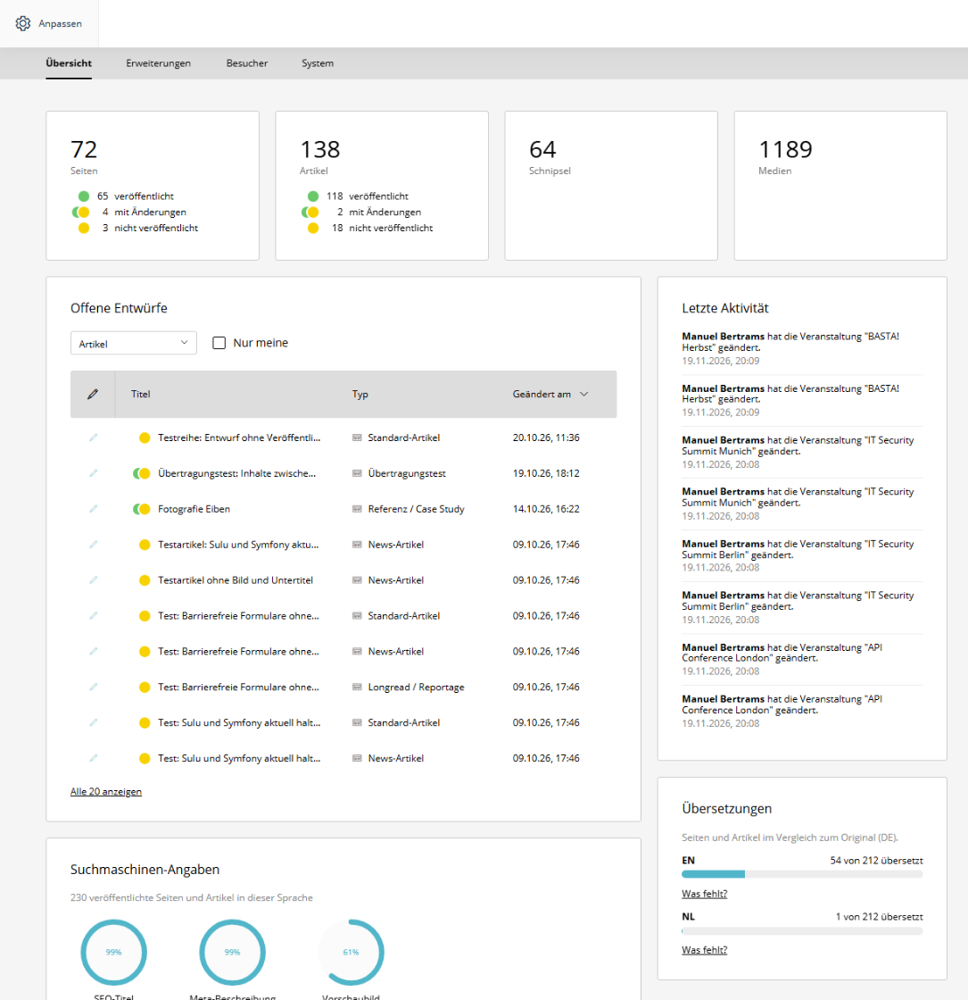

# SuluDashboardBundle!

[](https://github.com/manuxi/SuluDashboardBundle/blob/main/LICENSE)


[🇩🇪 German Version](README.de.md)

The SuluDashboardBundle gives the Sulu 3 admin a start page. Instead of an empty area, editors see what is left to do (open drafts), what happened lately, how complete the translations are and how much content there is.

The page is built only from the components of Sulu (toolbar with language select, grid, cards, tables, publish indicator). Other bundles and projects add their own tiles with a small PHP class, without JavaScript.



*The screenshots show the German admin.*

## ✨ Features

- **Open drafts** - Pages and articles that are not live as edited, sortable, filter by type and "Only mine", pen button to the form
- **Figures** - Pages, articles, snippets and media, split by publish state with Sulu's publish indicator
- **Translations** - Missing and outdated translations per language, with a list of what is missing
- **Recent activity** - From Sulu's activity API
- **Customize** - Every user can arrange, hide and reset tiles; the columns balance themselves until then
- **Permissions** - Own permission for the dashboard; every tile respects the permissions of the content and its own security context
- **Tile interface** - `DashboardWidgetInterface`, display types `number`, `progress`, `list`, `bars` and `custom` (own React component)
- **Tabs** - Bundles can add a whole page as a tab (`DashboardTabProviderInterface`); with `amoifr/sulu-log-stats-bundle` the dashboard gets the tab "Visitors" and a tile
- **Errors stay in their tile** - Every tile loads its data on its own

## 📋 Prerequisites

- PHP 8.2 or higher
- Sulu CMS 3.0 or higher
- Symfony 6.4 or higher

## 👩🏻‍🏭 Installation

### Step 1: Install the package

```bash
composer require manuxi/sulu-dashboard-bundle
```

Without Symfony Flex, add the bundle to `config/bundles.php`:

```php
return [
    //...
    Manuxi\SuluDashboardBundle\SuluDashboardBundle::class => ['all' => true],
];
```

### Step 2: Configure routes

Add to `config/routes_admin.yaml`:

```yaml
SuluDashboardBundle:
    resource: '@SuluDashboardBundle/Resources/config/routes_admin.yaml'
```

### Step 3: Admin JavaScript

In `assets/admin/package.json`:

```json
"sulu-dashboard-bundle": "file:../../vendor/manuxi/sulu-dashboard-bundle/src/Resources/js"
```

In `assets/admin/app.js`:

```js
import 'sulu-dashboard-bundle';
```

Then build the admin (`npm install`, `npm run build` in `assets/admin`) and clear the cache.

### Step 4: Grant permissions

1. Go to Sulu Admin → Settings → User Roles
2. Find the role, open the group **Settings**
3. Enable "view" for `sulu.settings.dashboard`
4. Reload the page

The dashboard has no database tables.

## 🎣 Usage

After the login the admin opens the dashboard; the first menu item **Dashboard** leads back to it. The language select in the toolbar sets the content language of the tiles.

Check what a user sees without logging in:

```bash
php bin/console sulu:dashboard:dump --user=admin --locale=en
```

### Your own tile

```php
final class ProjectsWidget implements DashboardWidgetInterface
{
    // getKey(), getTitle(), getType(), getSecurityContext(), getColumn(), getPriority() ...

    public function getData(string $locale): array
    {
        return ['value' => $this->projects->count()];
    }
}
```

With `autoconfigure` the class is found automatically. More: [Your own tile in 5 minutes](docs/widgets.en.md), including an optional dependency for other bundles.

## 🧶 Configuration

```yaml
# config/packages/sulu_dashboard.yaml
sulu_dashboard:
    start_page: true       # true: dashboard on "/", Sulu's search moves to "/search"; false: dashboard on "/dashboard", search stays on "/"
    tabs:
        replace_navigation: true   # a tab may replace a menu item of another bundle (the statistics of the log statistics)
    layout:
        balance: true      # after loading, move tiles from the end of the longer column into the shorter one (once); false: tiles stay in their column
    disabled_widgets: []   # keys of tiles that are not shown, e.g. ['sulu_activities']
```

Sulu's search and the dashboard both want the path `/`. The router of the admin takes the first matching view, so with `start_page: true` the dashboard moves the search view `sulu_search.search` to `/search` (its name, menu item and links stay the same).

## 📖 Documentation

- [Your own tile in 5 minutes](docs/widgets.en.md) - Interface, display types, optional dependency, tag
- [Customize the dashboard](docs/customize.en.md) - Arrange, hide and reset tiles per user ([screenshot](docs/img/dashboard-customize.de.png), admin in German)
- [Tabs](docs/tabs.en.md) - A whole page of a bundle as a tab, visitors from the log statistics
- [Built-in tiles](docs/built-in-widgets.en.md) - Tiles, permissions, the permission of the dashboard

## 👩‍🍳 Contributing

Contributions are welcome! Please create issues or pull requests.

## 📝 License

This bundle is licensed under the MIT License. See [LICENSE](LICENSE).

## 🎉 Credits

Created and maintained by [manuxi](https://github.com/manuxi).

Thanks to the Sulu team for the great CMS and fantastic support!
