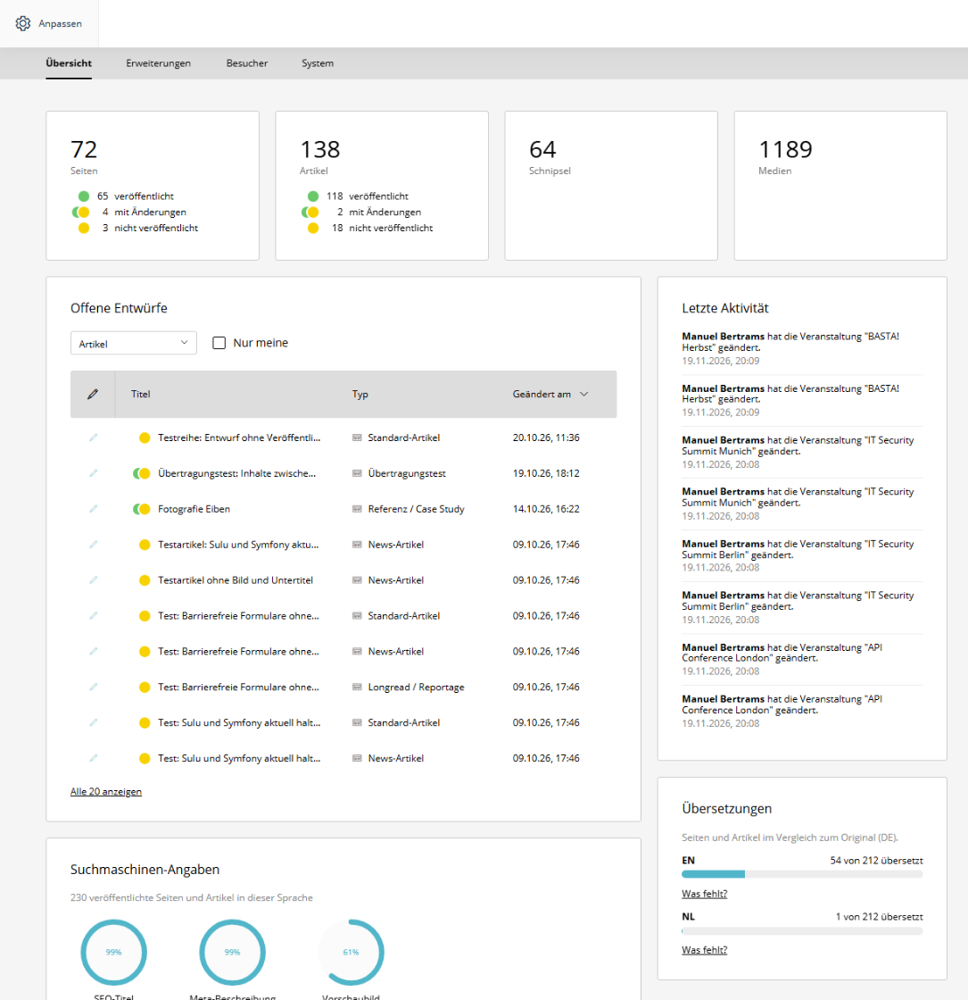
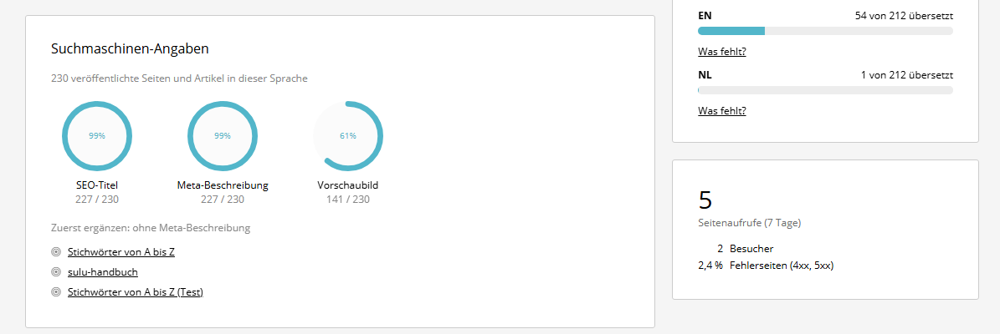

# Eingebaute Kacheln

Die Kacheln dieses Bundles nutzen dasselbe Interface wie die Kacheln anderer Bundles ([Eigene Kachel in 5 Minuten](widgets.de.md)). Die Sprachauswahl in der Toolbar stellt die Inhaltssprache aller Kacheln ein.

| Schlüssel | Kachel | Art | Spalte | Recht |
|---|---|---|---|---|
| `sulu_pages` | Seiten: Summe und Aufteilung nach Status | number | row | Webspace-Recht der jeweiligen Seite |
| `sulu_articles` | Artikel: Summe und Aufteilung nach Status | number | row | Recht des Artikeltyps |
| `sulu_snippets` | Schnipsel | number | row | `sulu.snippet.snippets` |
| `sulu_media` | Medien | number | row | `sulu.media.collections` |
| `sulu_open_items` | Offene Entwürfe | custom | main | Webspace und Artikeltyp |
| `sulu_seo` | Suchmaschinen-Angaben: Ringe und „Zuerst ergänzen“ | progress | main | Webspace und Artikeltyp |
| `sulu_translations` | Übersetzungen (nur bei mehr als einer Sprache) | custom | side | Webspace und Artikeltyp |
| `sulu_activities` | Letzte Aktivität | custom | side | `sulu.activities.activities` |
| `sulu_system` | System (klein): Ampel mit Link in den Tab „System“, siehe [System](system.de.md) | list | side | `sulu.settings.dashboard_system` |
| `sulu_system_*` | Tab „System“ (Gruppe `system`): Sicherheitslücken (breit), Letzte Prüfung, Versionen, Umgebung, Speicher, Migrationen, fehlgeschlagene Nachrichten | custom, list | main, side | `sulu.settings.dashboard_system` |
| `sulu_visitors` | Besucher (7 Tage), nur mit der Log-Statistik, siehe [Tabs](tabs.de.md) | custom | side | `sulu.settings.log_stats` |

## Rechte der Inhalte

Sulus List-API kann diese Fragen nicht in einer Anfrage beantworten (Zahlen je Workflow-Status über mehrere Webspaces und Artikeltypen, gemischte Listen aus Seiten und Artikeln). Das Bundle liest deshalb die aktuellen Zeilen der Inhaltstabellen selbst, nur lesend, und wendet dieselben Rechte an wie Sulu: Seiten nach dem Sicherheitskontext ihres Webspaces (`sulu.webspaces.<key>`), Artikel nach dem Kontext ihrer Typgruppe, wie die Artikelliste. Inhalte, die der Benutzer nicht sehen darf, werden weder gezählt noch aufgelistet. Die letzte Aktivität kommt aus Sulus eigener Aktivitäts-API, die Texte übersetzt und Rechte auf dem Server prüft.

Die Farben des Workflow-Status sind dieselben wie in Sulus Listen: Grün heißt, es gibt eine Live-Fassung, Orange heißt unveröffentlichte Änderungen.

## Offene Entwürfe

Seiten und Artikel, die nicht so live sind, wie sie bearbeitet wurden (nie veröffentlicht, unveröffentlichte Änderungen, zur Abnahme). Die Tabelle hat die Spalten Titel, Typ (Icon plus Titel des Templates, in der Admin-Sprache des Benutzers) und Geändert (Bearbeiter im Tooltip). Der Stift-Button öffnet den Eintrag. Filter (Typ, „Nur meine“) und Sortierung werden je Benutzer gespeichert. Zehn Zeilen sind sichtbar, „Alle anzeigen“ zeigt den Rest.

## Suchmaschinen-Angaben

Drei Ringe für die veröffentlichten Seiten und Artikel der gewählten Sprache: Anteil mit eigenem SEO-Titel, mit Meta-Beschreibung und mit Vorschaubild (Excerpt-Bild). Darunter listet „Zuerst ergänzen“ bis zu fünf Einträge ohne Meta-Beschreibung, jüngste Änderung zuerst, mit Link in den SEO-Tab ihres Formulars. 

Die Kachel kennt nur, was Sulu speichert. Regeln eines Projekts (zum Beispiel eine Längenprüfung des Titels) gehören in eine Kachel dieses Projekts.

## Übersetzungen

Je Sprache außer dem Original: wie viele Seiten und Artikel übersetzt sind, wie viele fehlen und wie viele veraltet sind. Die Originalsprache ist die Standardsprache des Webspaces (Artikel nutzen die Standardsprache des ersten Webspaces). Eine Übersetzung ist veraltet, wenn das Original mehr als einen Tag nach ihr geändert wurde. „Was fehlt?“ listet die ersten Einträge und öffnet das Formular dieser Sprache.

## Recht für das Dashboard

Unter Einstellungen → Benutzerrollen → Einstellungen entscheidet das Recht `sulu.settings.dashboard` („Ansehen“), ob eine Rolle das Dashboard bekommt. Ohne das Recht verhält sich Sulu wie bisher: kein Menüpunkt, eine leere Startseite.
