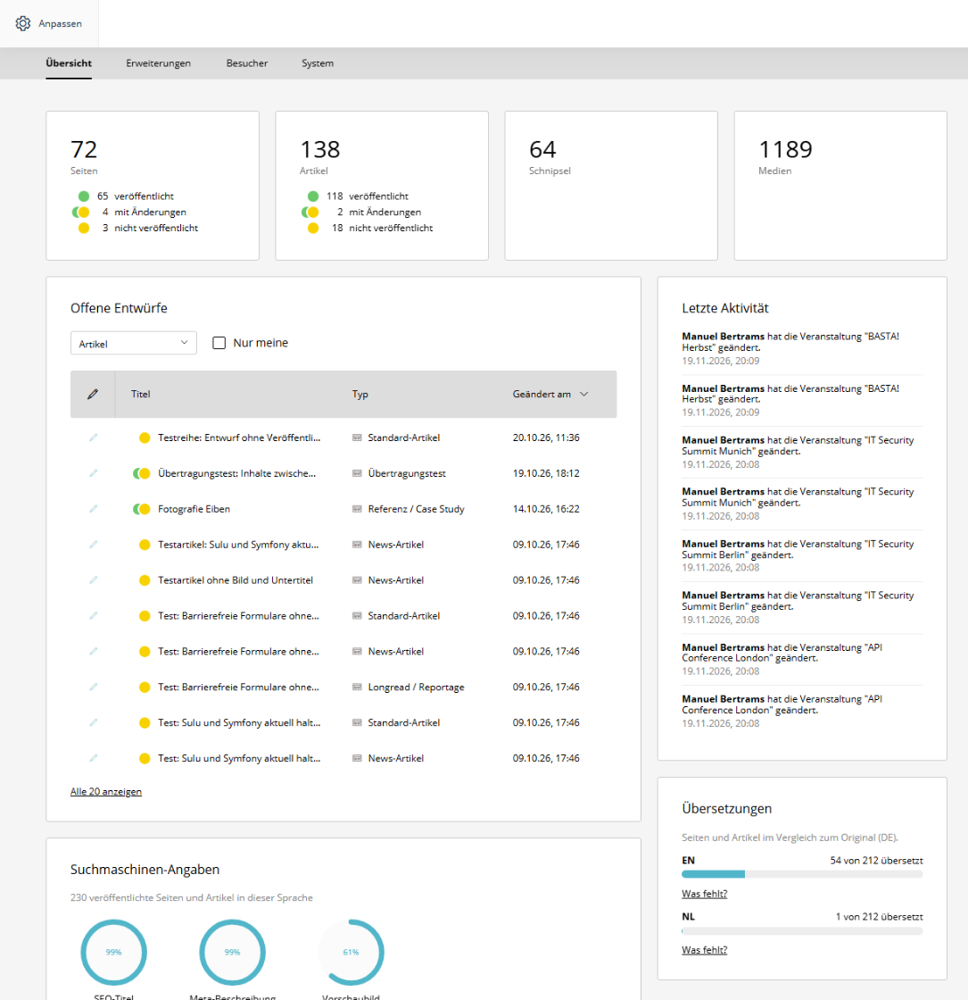
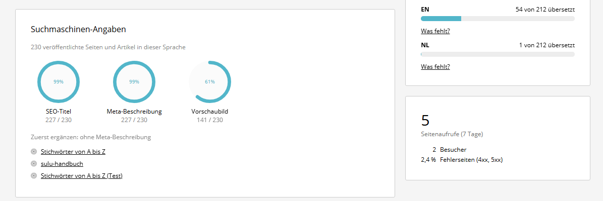

# Built-in tiles

The tiles of this bundle use the same interface as the tiles of other bundles ([Your own tile in 5 minutes](widgets.en.md)). The language select in the toolbar sets the content language of all tiles.

| Key | Tile | Type | Column | Permission |
|---|---|---|---|---|
| `sulu_pages` | Pages: total and split by state | number | row | webspace permission of each page |
| `sulu_articles` | Articles: total and split by state | number | row | permission of the article type |
| `sulu_snippets` | Snippets | number | row | `sulu.snippet.snippets` |
| `sulu_media` | Media | number | row | `sulu.media.collections` |
| `sulu_open_items` | Open drafts | custom | main | webspace and article type |
| `sulu_seo` | Search engine details: rings and rings with "What is missing?" | custom | main | webspace and article type |
| `sulu_translations` | Translations (only with more than one language) | custom | side | webspace and article type |
| `sulu_activities` | Recent activity | custom | side | `sulu.activities.activities` |
| `sulu_system_*` | Tab "System" (group `system`): condition (wide, first), security vulnerabilities (wide), storage, versions, environment | custom | main, side | `sulu.settings.dashboard_system` |
| `sulu_visitors` | Visitors (7 days), only with the log statistics and `log_stats.overview_tile: true`; otherwise the visitors are in the tab, see [Tabs](tabs.en.md) | custom | side | `sulu.settings.log_stats` |

*The screenshots show the German admin.*

## Permissions of the content

Sulu's list API cannot answer these questions in one request (counts per workflow state across webspaces and article types, mixed lists of pages and articles). The bundle therefore reads the current rows of the content tables itself, read only, and applies the same permissions as Sulu: pages by the security context of their webspace (`sulu.webspaces.<key>`), articles by the context of their type group, like the article list. Content the user may not see is neither counted nor listed. The recent activity comes from Sulu's own activity API, which translates the texts and checks the permissions on the server.

The colours of the workflow state are the same as in Sulu's lists: green means a live version exists, orange means unpublished changes.

## Open drafts

Pages and articles that are not live as edited (never published, unpublished changes, in review). The table has the columns title, type (icon plus the title of the template, in the admin language of the user) and changed (the editor in the tooltip). The pen button opens the entry. Filter (type, "Only mine") and sort order are saved per user. Ten rows are shown, "Show all" shows the rest.

## Search engine details

Three rings for the published pages and articles of the chosen language: share with an own SEO title, with a meta description and with a preview image (the excerpt image). Under each ring "What is missing?" opens the list of the pages and articles that lack exactly this detail: type icon, title, newest change first. A click on the title opens the form in the chosen language straight in the matching tab: the "SEO" tab for SEO title and meta description, the "Excerpt" tab for the preview image. Ten entries show at first, "Show all" shows up to 50. Only one list is open at a time. Only what the user may see is listed (webspace permission of the page, permission of the article type). One query per kind of content (pages, articles) delivers the figures and all three lists together. 

The tile only knows what Sulu stores. Rules of a project (for example a length check of the title) belong in a tile of that project.

## Translations

For each language except the original: how many pages and articles are translated, how many are missing and how many are outdated. The original language is the default language of the webspace (articles use the default language of the first webspace). A translation is outdated when the original was changed more than a day after it. "What is missing?" lists the first entries and opens the form of that language.

## Permission for the dashboard

Under Settings → User Roles → Settings, the permission `sulu.settings.dashboard` ("view") decides whether a role gets the dashboard. Without it Sulu behaves as before: no menu item, an empty start page.
