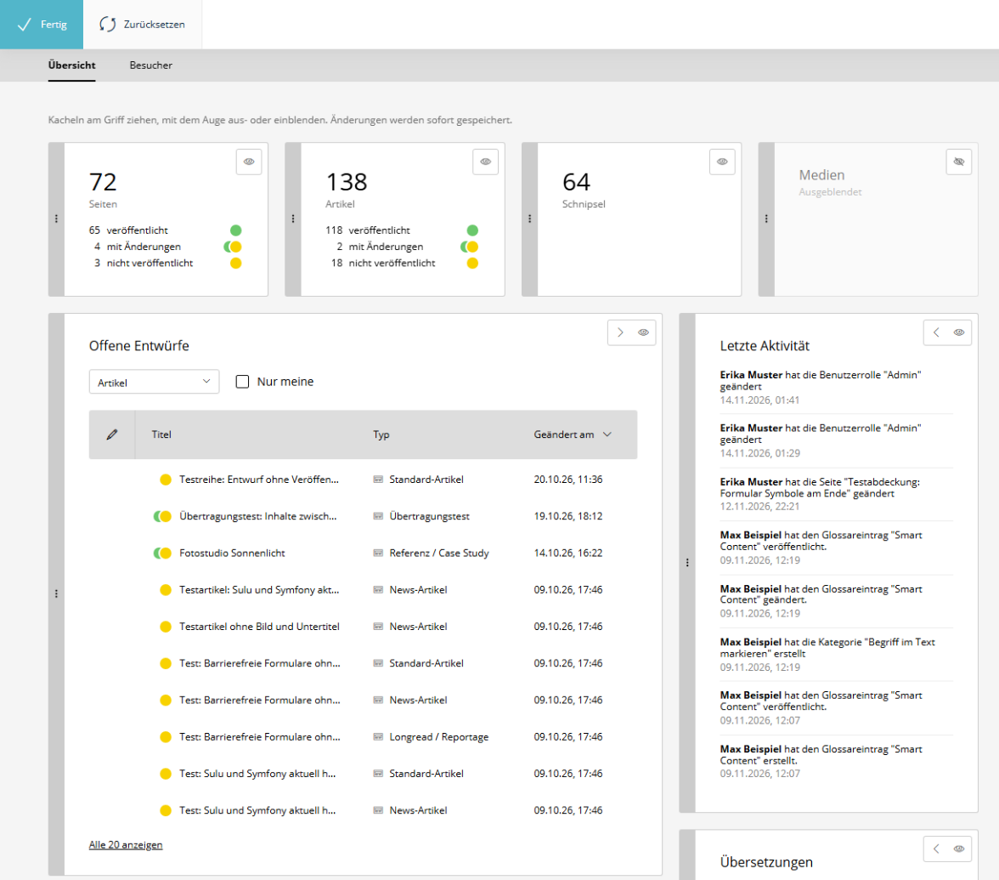

# Dashboard anpassen

Jeder kann das Dashboard für sich anordnen: Kacheln verschieben, nicht benötigte ausblenden. Die Seite bleibt ruhig, bis man es will.

## Anordnen

1. In der Toolbar auf **Anpassen** klicken. Jede Kachel hat nun links einen Griff (derselbe wie bei Sulus Blöcken) und oben rechts zwei kleine Buttons.
2. **Verschieben:** Eine Kachel am Griff an eine andere Stelle ihrer Spalte ziehen. Die Zeile mit den Kennzahlen oben lässt sich innerhalb der Zeile umsortieren; ihre Kacheln wandern nicht in die Spalten.
3. **Andere Spalte:** Der Pfeil-Button schiebt eine Kachel ans Ende der anderen Spalte.
4. **Ausblenden:** Der Augen-Button blendet eine Kachel aus. In diesem Modus bleibt sie gedimmt stehen und lässt sich mit demselben Button wieder einblenden. Außerhalb des Modus wird eine ausgeblendete Kachel nicht angezeigt und lädt auch keine Daten.
5. Auf **Fertig** klicken. Jede Änderung wird sofort gespeichert, es geht also nichts verloren, wenn man die Seite ohne „Fertig“ verlässt.

Beim Anordnen reagieren die Kacheln nicht auf Klicks, so öffnet sich kein Link aus Versehen.

## Zurücksetzen

**Zurücksetzen** löscht die eigene Anordnung. Danach entscheidet wieder der automatische Ausgleich der Spalten (siehe [Eigene Kachel in 5 Minuten](widgets.de.md), „Ausgleich der Spalten“), und ausgeblendete Kacheln sind wieder da.

## Was gespeichert wird

Die Anordnung ist eine Benutzereinstellung von Sulu (`sulu_dashboard.layout`, je Benutzer auf dem Server, wie die Filter der offenen Entwürfe). Sie enthält die Schlüssel der Kacheln je Platz und die ausgeblendeten.

- Eine gespeicherte Anordnung gewinnt gegen den Ausgleich der Spalten. Nur der Benutzer ersetzt sie.
- Eine Kachel, die später dazukommt (neues Bundle, neues Recht), steht nicht in der Liste. Sie wird automatisch einsortiert, in die kürzere Spalte hinter die anderen, die übrige Anordnung bleibt. Was der Benutzer ausgeblendet hat, bleibt ausgeblendet.
- Kacheln, die der Benutzer gerade nicht sehen darf (Recht, `disabled_widgets`), werden übergangen; ihr Zustand „ausgeblendet“ bleibt erhalten.
- Kacheln lassen sich nicht von einer Spalte in die andere ziehen, weil die Bibliothek hinter Sulus Block-Listen (react-sortable-hoc) nur innerhalb einer Liste sortiert. Den Wechsel übernimmt der Pfeil-Button.
- Jeder Tab aus Kacheln (siehe [Tabs](tabs.de.md), „Ein Tab aus Kacheln“) speichert seine Anordnung unter einem eigenen Schlüssel (`sulu_dashboard.layout.<gruppe>`). Übersicht und Tabs werden getrennt angeordnet und zurückgesetzt. „Zurücksetzen“ in einem Tab berührt die anderen nicht, und auch nicht den gewählten Zeitraum.
