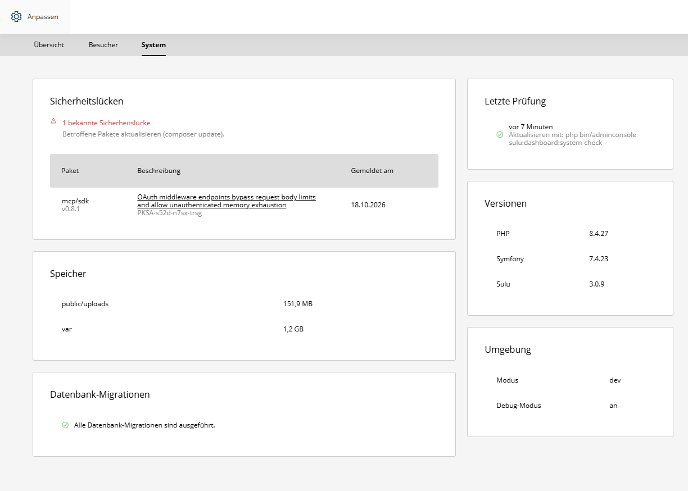
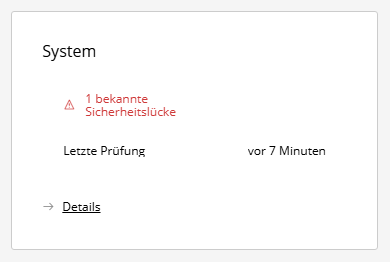

# Der Tab „System“

Für Administratoren: Versionen, Umgebung und das, was man nicht vergessen sollte. Der Tab erscheint nur bei Benutzern mit eigenem Recht, Redakteure sehen ihn nie. Auf der Übersicht bleibt nur eine kleine Kachel als Ampel mit dem Link „Details“.





## Aufbau

Der Tab besteht wie „Besucher“ aus Kacheln (Gruppe `system`). Sie lassen sich über „Anpassen“ anordnen, ausblenden und zurücksetzen. Die Anordnung wird je Benutzer gespeichert (`sulu_dashboard.layout.system`). Der Tab hat weder Zeitraum noch Sprachauswahl, die Werte hängen nicht davon ab.

| Kachel | Spalte | Inhalt |
|---|---|---|
| Sicherheitslücken | breit, angepinnt | Tabelle aus `composer audit`, siehe unten. Ohne Funde die Meldung „Keine bekannten Sicherheitslücken.“ Darunter die nicht mehr gepflegten Pakete, falls Composer welche meldet. |
| Letzte Prüfung | schmal | Alter der Hintergrundprüfung, bei „nie“ oder zu alt eine Warnung, immer mit dem Befehl als Text |
| Versionen | schmal | PHP, Symfony, Sulu |
| Umgebung | schmal | Modus (`prod`, `dev` ...) und Debug-Modus. **Debug an in `prod` ist eine rote Warnung**, weil Besucher dadurch interne Details sehen können (`APP_DEBUG=0`, danach den Cache leeren). |
| Speicher | schmal | Platz, den `public/uploads` und `var` belegen. Ohne Prüflauf der Hinweis, wie gemessen wird. |
| Datenbank-Migrationen | schmal | nur mit `doctrine/doctrine-migrations-bundle`: „Alle Datenbank-Migrationen sind ausgeführt.“ oder eine Warnung mit der Zahl offener Migrationen (nur lesend, es wird nichts ausgeführt) |
| Fehlgeschlagene Nachrichten | schmal | nur wenn Symfony Messenger einen `failure_transport` hat: grüne Zeile oder Warnung mit der Zahl (nur lesend, nichts wird wiederholt oder gelöscht) |

Schlüssel/Wert-Kacheln (Versionen, Umgebung, Speicher, Letzte Prüfung) haben keinen Tabellenkopf. Dafür kennt die Listen-Kachel die Option `'header' => false`, siehe [Eigene Kachel](widgets.de.md).

### Die Tabelle der Sicherheitslücken

Eine Zeile je Meldung, die schlimmste zuerst (kritisch, hoch, mittel, niedrig, ohne Angabe):

| Spalte | Quelle in `composer audit --format=json` |
|---|---|
| Paket | `packageName` |
| Version | installierte Version des Pakets im Projekt (aus Composers `InstalledVersions`, nicht Teil der Audit-Ausgabe) |
| Kennung | `cve`, sonst `advisoryId` (zum Beispiel `PKSA-…`) |
| Beschreibung | `title`, als Link auf `link` (öffnet in einem neuen Tab, `rel="noopener noreferrer"`). Nur `http`- und `https`-Adressen werden zu Links, alles andere bleibt Text. |
| Schweregrad | `severity` (`critical`, `high`, `medium`, `low`), oft leer: dann „–“ |
| Gemeldet am | `reportedAt`, nur das Datum |

Zehn Zeilen sind sichtbar, der Rest per „Alle anzeigen“. Gespeichert werden höchstens 200 Meldungen und nur diese Felder (nicht `sources`, `affectedVersions` oder die rohe Ausgabe). Nicht mehr gepflegte Pakete kommen aus `abandoned` (Paket, Ersatz).

## Die Kachel auf der Übersicht

Die frühere große Kachel `sulu_system` ist jetzt klein und behält ihren Schlüssel, damit gespeicherte Anordnungen weiter gelten. Sie zeigt eine Ampel: für jedes Problem eine Zeile (rot: Sicherheitslücken, Debug in `prod`; gelb: Prüfung nie gelaufen oder zu alt, aufgegebene Pakete, offene Migrationen, fehlgeschlagene Nachrichten), sonst eine grüne Zeile „Alles in Ordnung“, dazu das Alter der letzten Prüfung und den Link „Details“ in den Tab.

Es wird nichts Geheimes gezeigt: keine Verbindungsdaten, Schlüssel oder absoluten Pfade, nur Versionen, Zahlen, Paketnamen und die relativen Ordnernamen. Eine Prüfung, die scheitert, zeigt nie die Fehlermeldung, nur einen kurzen festen Text. Einzelheiten stehen im Log.

## Recht

Unter Einstellungen → Benutzerrollen → Einstellungen das Recht `sulu.settings.dashboard_system` („Ansehen“). Es ist unabhängig von `sulu.settings.dashboard`: Eine Rolle braucht beide, um den Tab und die Kachel zu sehen. Ohne das Recht gibt es keinen Tab „System“ und keine Tab-Leiste, wenn er der einzige wäre. Zunächst hat keine Rolle es: den Haken nur bei der Administrator-Rolle setzen.

## Die Hintergrundprüfung (Cron)

`composer audit` fragt das Internet, und das Zählen der Ordner kann dauern. Beides gehört nicht in einen Seitenaufruf, deshalb erledigt es ein Konsolenbefehl und legt das Ergebnis für den Tab ab:

```bash
php bin/adminconsole sulu:dashboard:system-check
```

Einmal am Tag ausführen, zum Beispiel mit diesem Cron-Eintrag (Pfad anpassen):

```
15 4 * * * cd /pfad/zum/projekt && php bin/adminconsole sulu:dashboard:system-check >> var/log/system-check.log 2>&1
```

- `bin/adminconsole` verwenden: Die Tab liest den Cache des Admins, und der Befehl speichert dort.
- Eine gescheiterte Prüfung endet mit Exit-Code 1 (Composer nicht gefunden, kein Internet, zu langsam), eine gefundene Lücke nicht: Die Prüfung selbst hat funktioniert.
- **Solange der Befehl nie gelaufen ist, steht im Tab „Die Hintergrundprüfung ist noch nie gelaufen“** und er zeigt weder Sicherheitslücken noch Ordnergrößen. Ist der letzte Lauf älter als 48 Stunden, warnt der Tab, dass der Cronjob stehen geblieben sein könnte (`sulu_dashboard.system.max_age`, in Stunden, bei einem wöchentlichen Cronjob zum Beispiel 200).
- `cache:clear` löscht auch dieses Ergebnis. Den Befehl am Ende eines Deployments nach `cache:clear` ausführen.
- Hosting ohne crontab: die Cron-Funktion des Anbieters den Befehl starten lassen, oder ihn ab und zu von Hand ausführen. Ein Skript, das den Befehl über eine geheime URL aufruft, wäre nur eine Idee, das Bundle bringt keine solche Route mit.
- Composer muss für den Benutzer des Cronjobs aufrufbar sein. Findet der Befehl Composer unter diesem Namen nicht, den Pfad eintragen: `sulu_dashboard.system.composer_binary: '/usr/local/bin/composer'` oder den Pfad zu einer `composer.phar`. Ohne `HOME`-Verzeichnis (manche Cron-Umgebungen) braucht Composer vor dem Befehl `COMPOSER_HOME=/pfad/zu/einem/beschreibbaren/ordner`. Ohne `composer.lock` im Projekt gibt es nichts zu prüfen.

## Prüfen ohne Login

```bash
php bin/adminconsole sulu:dashboard:system-check
php bin/adminconsole sulu:dashboard:dump --user=admin --widget=sulu_system
php bin/adminconsole sulu:dashboard:dump --user=admin --group=system
```

Der Benutzer braucht das Recht `sulu.settings.dashboard_system`, sonst fehlen die Kacheln in der Ausgabe (genauso wie im Browser).

## Konfiguration

```yaml
sulu_dashboard:
    system:
        composer_binary: composer   # Befehl im PATH oder Pfad zu einer composer.phar
        max_age: 48                 # Stunden, nach denen die letzte Prüfung als zu alt gilt
    disabled_widgets: ['sulu_system', 'sulu_system_storage']   # schaltet Kacheln ab (Übersicht und Tab)
```
