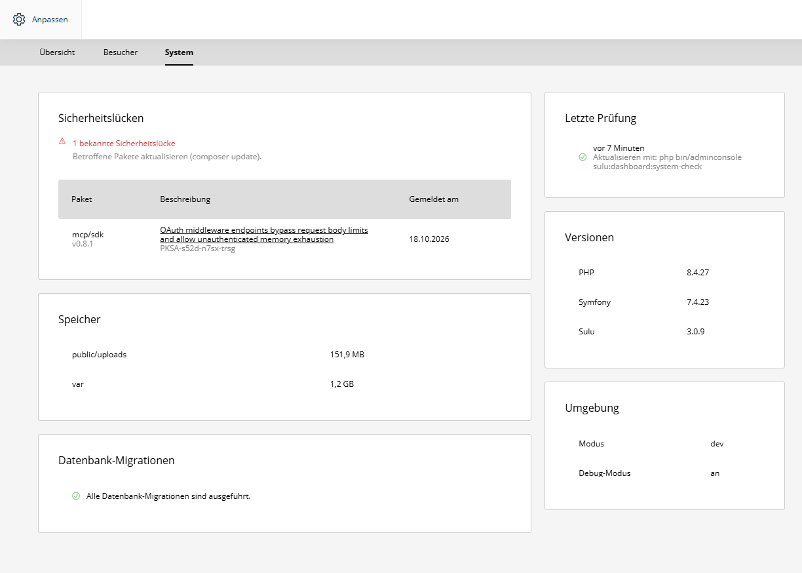

# The tab "System"

For administrators: what needs attention, versions, environment and the things that should not be forgotten. The tab only appears for users who have its own permission, so editors never see it. Nothing of it is on the overview.



## Layout

Like "Visitors", the tab is made of tiles (group `system`). With "Customize" they can be arranged, hidden and reset. The arrangement is saved per user (`sulu_dashboard.layout.system`). The tab has neither a period nor a language select, the values do not depend on them.

| Tile | Column | Content |
|---|---|---|
| Condition | wide, pinned, first | a headline ("Everything is in order" or "3 items need attention", in the colour of the worst finding) and a row with an icon per check, see below |
| Security vulnerabilities | wide, pinned | table from `composer audit`, see below. Without findings the message "No known security vulnerabilities." Below it the packages that are no longer maintained, if Composer reports any. |
| Storage | wide | total size and one bar per folder with its share, see below. Without a run the hint how it is measured. |
| Versions | narrow | PHP with the end of its security support, Symfony, Sulu; a newer patch release is named, see below |
| Environment | narrow | mode (`prod`, `dev` ...), debug mode, memory limit, time limit, OPcache, time zone, default language, see below |

Condition, Versions and Environment are lists of facts without Sulu table cells: no indent, compact rows, the name on the left, the value on the right, a grey line below where it helps, and Sulu's icons for ok, warning and error. One component draws all three, so they look the same. A tile of your own can use it too: it is the type `custom` with the key of your tile, see [Own tile](widgets.en.md).

### The tile "Condition"

One row per check, in this order. A row has the green check, the yellow warning or the red error sign.

| Row | Green | Yellow | Red |
|---|---|---|---|
| Security vulnerabilities | none known | check never ran, or could not run | found (with the number) |
| Packages | all maintained | some are no longer maintained | |
| PHP support | until 31 Dec 2028 | the security support ends within half a year | it has ended |
| Debug mode | off (in `dev` also on) | | on in `prod`: visitors could see internal details (`APP_DEBUG=0`, then clear the cache) |
| Database migrations | all have run | open ones (with the number), or not readable | |
| Failed messages | none | some (with the number), or not countable | |
| Cache, logs | | only as a row when `var/cache` or `var/log` is bigger than the threshold | |
| Last check | age of the background check | never, or older than `max_age`, always with the command as text | |

Migrations and failed messages have a row only where there is something to read (`doctrine/doctrine-migrations-bundle`, a `failure_transport` of Symfony Messenger; read only, nothing is run, retried or deleted). The headline counts every row that is not green.

### The tiles "Versions" and "Environment"

- **PHP**: the version and below it "Security updates until 31 Dec 2028". The end dates come from a fixed table in the code (source: php.net/supported-versions.php, `PhpSupport::SECURITY_UNTIL`), nothing is asked online. A test fails as soon as the PHP that runs the tests is not in the table: a new minor version has to be added then. Versions the table does not know get no statement.
- **Newer patch release**: if `composer outdated --direct --patch-only` finds a newer patch version of Sulu or Symfony (`symfony/framework-bundle`), the row says "Patch update available: 3.0.11" with a yellow icon. A patch release stays inside the version the project chose, so it is the safe kind of update. Composer asks the internet for this (about ten seconds), so it only runs in the console command. Without internet or without Composer the rows simply say nothing (the console output and the URL cron response then name the reason). Only direct requirements are checked.
- **Environment**: the live values of the running PHP: mode, debug mode, `memory_limit`, `max_execution_time`, OPcache (**yellow in `prod` if it is off**), time zone and the default language of the kernel. No paths, no keys, no connection data.

### The tile "Storage"

The tile answers: where does the space go, and is something growing unusually? It shows

- the **total size** of the measured folders and below it a **bar with size and share** for every area: `public/uploads` (generated image formats and uploads), `var/cache`, `var/log`, `var/storage` (file storage of the media) and every other folder in `var`. Loose files in `var` appear as "Other files in var". The six biggest areas get a bar, the rest is summed up in one row ("3 more folders").
- the **change since the last measurement**, for example "+12.0 MB since the measurement 1 day ago", for the total and per folder. A change below 1 MB is not mentioned. The comparison is always the measurement before; if the command runs several times a day the window is shorter, and the tile says so.
- for **media** the number of media and the size of the originals. They come from Sulu's media tables (`me_media`, `me_file_versions`) and are read by the command only. Without the tables the line is left out.
- a **hint** when `var/cache` or `var/log` is bigger than the threshold (the bar turns yellow): "The cache is 1.9 GB. Clear it with cache:clear ..." or "Rotate or delete old log files." The hint also appears as a warning row in the tile "Condition".
- always the **age of the measurement**: "Measured 3 hours ago by the command sulu:dashboard:system-check, not live." If the measurement is older than `max_age` the warning that the cron job has probably stopped replaces it.

Left out on purpose: **free disk space**. On shared hosting PHP reports the space of the whole server disk, not the quota of the account; such a number would mislead. Likewise the size of the whole project (counting `vendor` and `node_modules` takes too long) and the biggest media collections.

The total is the sum of the measured folders, not the size of the disk.

### The table of vulnerabilities

One row per report, the worst first (critical, high, medium, low, none given):

| Column | Source in `composer audit --format=json` |
|---|---|
| Package | `packageName` |
| Version | installed version of the package in the project (from Composer's `InstalledVersions`, not part of the audit output) |
| ID | `cve`, otherwise `advisoryId` (for example `PKSA-...`) |
| Description | `title`, as a link to `link` (opens in a new tab, `rel="noopener noreferrer"`). Only `http` and `https` addresses become links, anything else stays text. |
| Severity | `severity` (`critical`, `high`, `medium`, `low`), often empty: then "–" |
| Reported on | `reportedAt`, the date only |

Ten rows are visible, the rest with "Show all". At most 200 reports are saved, and only these fields (not `sources`, `affectedVersions` or the raw output). Packages that are no longer maintained come from `abandoned` (package, replacement).

## Nothing on the overview any more

The small traffic light `sulu_system` has left the overview, its content is the first tile of the tab ("Condition"). Saved arrangements of the overview that still name `sulu_system` do no harm: a key that no tile has any more is ignored. `disabled_widgets: ['sulu_system']` stays valid and does nothing. The tiles "Last check", "Database migrations" and "Failed messages" of the first versions of the tab are rows of the condition now, their saved places are ignored the same way.

Nothing secret is shown: no connection strings, keys or absolute paths, only versions, counts, package names and the relative folder names. A check that fails never shows the message of the error, only a short fixed text. Details go to the log.

## Permission

Under Settings → User Roles → Settings, the permission `sulu.settings.dashboard_system` ("view"). It is separate from `sulu.settings.dashboard`: a role needs both to see the tab. Without it there is no tab "System" (and no tab bar, if it would be the only one). No role has it at first, tick it for the administrator role only.

## The background check (cron)

`composer audit` asks the internet and counting the folders can take a while. Neither belongs in a request, so a console command does it and leaves the result for the tab:

```bash
php bin/adminconsole sulu:dashboard:system-check
```

Run it once a day, for example with this cron entry (adjust the path):

```
15 4 * * * cd /path/to/project && php bin/adminconsole sulu:dashboard:system-check >> var/log/system-check.log 2>&1
```

- Use `bin/adminconsole` or `bin/websiteconsole`: the command exists in both contexts and saves to the same place (see below), so the tab shows the result either way.
- A failed check ends with exit code 1 (Composer not found, no internet, too slow), a found vulnerability does not: the check itself worked. The reason is not hidden: the output says "Composer said: ..." with the error output of Composer (at most 300 characters; colours, the project path, other paths and anything that looks like a secret are removed), and the tile "Security vulnerabilities" shows it below the message. For the updates it is the line "Updates: could not be checked: ...".
- **Until the command has run, the condition says that nothing was checked yet** and the tab shows no vulnerabilities and no folder sizes. The result is kept in the storage folder (see below) and also contains the measurement before it (for the change). If the last run is older than 48 hours the tab warns that the cron job may have stopped (`sulu_dashboard.system.max_age`, in hours, for a weekly cron job for example 200).
- `cache:clear` does not delete the result, and neither does a deployment that replaces the cache folders: the result lives in its own folder, `var/sulu-dashboard` (see "Where the result is kept"). The change since the last measurement therefore survives a deployment.
- Hosting without a crontab: see "Without a crontab: the system check as a URL cron" below.
- Composer must be callable by the user of the cron job. If the command finds it under another name or path, set it: `sulu_dashboard.system.composer_binary: '/usr/local/bin/composer'` or the path to a `composer.phar`. Without `composer.lock` in the project there is nothing to check. Composer also needs a home and a cache folder: where the environment brings none (no `HOME`, on Windows no `APPDATA`/`LOCALAPPDATA`; typical for cron and for the PHP of a web server) the bundle starts Composer with `COMPOSER_HOME` and `COMPOSER_CACHE_DIR` in `var/sulu-dashboard/composer` of its own. A `COMPOSER_HOME` that the server sets is respected; `sulu_dashboard.system.composer_home` sets a folder that is always used.

### Where the result is kept

The result is saved in a cache pool of its own (`sulu_dashboard.system_cache`, a `FilesystemAdapter`) in the folder `var/sulu-dashboard` of the project. It is no part of `cache.app`: Sulu gives every context its own cache folder (`var/cache/admin`, `var/cache/website`), so a result in `cache.app` would be invisible to the other context and would be deleted by `cache:clear`. The own folder is read and written by both contexts and survives `cache:clear`. The folder needs no setup, the command creates it; it must be writable for the user of the web server and of the cron job. Where that is not possible, change the folder:

```yaml
sulu_dashboard:
    system:
        storage_dir: '%kernel.project_dir%/var/sulu-dashboard'   # the default
```

Results that earlier versions left in `cache.app` are not read any more; after the update the tab says "never" until the command has run once. Nothing breaks.

### Without a crontab: the system check as a URL cron

Some shared hosting offers only a "URL cron": the provider calls a web address at fixed times. The command is available in the website context for this, so a small controller of the project can start it. The example uses a secret in the URL (kept in an environment variable) and runs the command in the running kernel:

```php
use Symfony\Bundle\FrameworkBundle\Console\Application;
use Symfony\Component\Console\Input\ArrayInput;
use Symfony\Component\Console\Output\BufferedOutput;
use Symfony\Component\HttpFoundation\Response;
use Symfony\Component\HttpKernel\KernelInterface;
use Symfony\Component\Routing\Attribute\Route;

final class SystemCheckCronController
{
    public function __construct(private readonly string $cronToken)
    {
    }

    #[Route('/cron/system-check/{token}', methods: ['GET'])]
    public function __invoke(KernelInterface $kernel, string $token): Response
    {
        if (!hash_equals($this->cronToken, $token)) {
            return new Response('', Response::HTTP_NOT_FOUND);
        }

        set_time_limit(300);

        $application = new Application($kernel);
        $application->setAutoExit(false);

        $output = new BufferedOutput();
        $exitCode = $application->run(new ArrayInput(['command' => 'sulu:dashboard:system-check']), $output);

        return new Response($output->fetch(), 0 === $exitCode ? 200 : 500, ['Content-Type' => 'text/plain']);
    }
}
```

Register the controller like any other of the project and give it `$cronToken` (for example `'%env(SYSTEM_CHECK_CRON_TOKEN)%'`). Enter the address `https://example.org/cron/system-check/<secret>` in the cron function of the provider (once a day is enough). Keep the route out of the sitemap and the cache, and do not log the address.

Two things the web PHP needs:

- **Network access**: Composer asks packagist.org. If the web PHP has no access (firewall, proxy, a PHP without `openssl`), the security check says "Composer cannot fetch the security database. Check the network access of the web PHP or run the command over SSH." and the updates are skipped. Proxy settings (`HTTPS_PROXY`) are inherited from the PHP environment.
- `proc_open` must not be disabled in `disable_functions`: the check starts Composer (`composer audit`, `composer outdated`) as a process. Where it is disabled, Composer cannot be started: the tab then reports the security check as "could not run" (the folder sizes are still saved).
- Composer must be callable by the PHP of the web server. Often the plain command `composer` does not exist there. Then set `sulu_dashboard.system.composer_binary` to the path of a `composer.phar` in the project. A missing home directory of the account (`HOME`, on Windows `APPDATA`) needs no setup: Composer gets its own folder `var/sulu-dashboard/composer` (see "The background check"). Without it Composer would stop with "The APPDATA or COMPOSER_HOME environment variable must be set". The web PHP also has a `max_execution_time`: the command takes about ten to thirty seconds, `set_time_limit()` in the controller helps where the provider allows it.

## Check without a login

```bash
php bin/adminconsole sulu:dashboard:system-check
php bin/adminconsole sulu:dashboard:dump --user=admin --widget=sulu_system_status
php bin/adminconsole sulu:dashboard:dump --user=admin --group=system
```

The user must have the permission `sulu.settings.dashboard_system`, otherwise the tiles are missing from the output (that is the same as for the browser).

## Configuration

```yaml
sulu_dashboard:
    system:
        composer_binary: composer   # command in the PATH or path to a composer.phar
        composer_home: ~            # folder for the home and cache of Composer; null: Composer's own, var/sulu-dashboard/composer only where the environment has none
        storage_dir: '%kernel.project_dir%/var/sulu-dashboard'   # folder of the result (both contexts, not deleted by cache:clear)
        max_age: 48                 # hours after which the last check counts as too old
        cache_limit: 1024           # MB: from this size of var/cache the tile "Storage" gives a hint (0 = off)
        log_limit: 512              # MB: the same for var/log (0 = off)
    disabled_widgets: ['sulu_system_environment', 'sulu_system_storage']   # switches tiles off (overview and tab)
```
