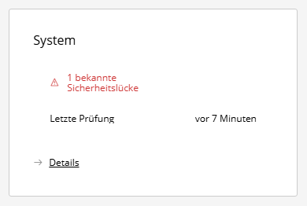

# The tab "System"

For administrators: versions, environment and the things that should not be forgotten. The tab only appears for users who have its own permission, so editors never see it. The overview keeps only a small tile as a traffic light with a "Details" link.




## Layout

Like "Visitors", the tab is made of tiles (group `system`). With "Customize" they can be arranged, hidden and reset. The arrangement is saved per user (`sulu_dashboard.layout.system`). The tab has neither a period nor a language select, the values do not depend on them.

| Tile | Column | Content |
|---|---|---|
| Security vulnerabilities | wide, pinned | table from `composer audit`, see below. Without findings the message "No known security vulnerabilities." Below it the packages that are no longer maintained, if Composer reports any. |
| Last check | narrow | age of the background check, a warning for "never" or too old, always with the command as text |
| Versions | narrow | PHP, Symfony, Sulu |
| Environment | narrow | mode (`prod`, `dev` ...) and debug mode. **Debug on in `prod` is a red warning**, because it can reveal internal details to visitors (`APP_DEBUG=0`, then clear the cache). |
| Storage | narrow | space used by `public/uploads` and `var`. Without a run the hint how it is measured. |
| Database migrations | narrow | only with `doctrine/doctrine-migrations-bundle`: "All database migrations have run." or a warning with the number of open migrations (read only, nothing is run) |
| Failed messages | narrow | only when Symfony Messenger has a `failure_transport`: green row or a warning with the number (read only, nothing is retried or deleted) |

Key/value tiles (Versions, Environment, Storage, Last check) have no table head. The list tile knows the option `'header' => false` for it, see [Own tile](widgets.en.md).

### The table of vulnerabilities

One row per report, the worst first (critical, high, medium, low, none given):

| Column | Source in `composer audit --format=json` |
|---|---|
| Package | `packageName` |
| Version | installed version of the package in the project (from Composer's `InstalledVersions`, not part of the audit output) |
| ID | `cve`, otherwise `advisoryId` (for example `PKSA-...`) |
| Description | `title`, as a link to `link` (opens in a new tab, `rel="noopener noreferrer"`). Only `http` and `https` addresses become links, anything else stays text. |
| Severity | `severity` (`critical`, `high`, `medium`, `low`), often empty: then "–" |
| Reported on | `reportedAt`, the date only |

Ten rows are visible, the rest with "Show all". At most 200 reports are saved, and only these fields (not `sources`, `affectedVersions` or the raw output). Packages that are no longer maintained come from `abandoned` (package, replacement).

## The tile on the overview

The former large tile `sulu_system` is now small and keeps its key, so saved arrangements still apply. It shows a traffic light: a row per problem (red: vulnerabilities, debug in `prod`; yellow: check never ran or too old, abandoned packages, open migrations, failed messages), otherwise a green row "Everything is in order", plus the age of the last check and the "Details" link to the tab.

Nothing secret is shown: no connection strings, keys or absolute paths, only versions, counts, package names and the relative folder names. A check that fails never shows the message of the error, only a short fixed text. Details go to the log.

## Permission

Under Settings → User Roles → Settings, the permission `sulu.settings.dashboard_system` ("view"). It is separate from `sulu.settings.dashboard`: a role needs both to see the tab and the tile. Without it there is no tab "System" (and no tab bar, if it would be the only one). No role has it at first, tick it for the administrator role only.

## The background check (cron)

`composer audit` asks the internet and counting the folders can take a while. Neither belongs in a request, so a console command does it and leaves the result for the tab:

```bash
php bin/adminconsole sulu:dashboard:system-check
```

Run it once a day, for example with this cron entry (adjust the path):

```
15 4 * * * cd /path/to/project && php bin/adminconsole sulu:dashboard:system-check >> var/log/system-check.log 2>&1
```

- Use `bin/adminconsole`: the tab reads the cache of the admin, and the command saves into it.
- A failed check ends with exit code 1 (Composer not found, no internet, too slow), a found vulnerability does not: the check itself worked.
- **Until the command has run, the tab says "The background check has not run yet"** and shows no vulnerabilities and no folder sizes. If the last run is older than 48 hours the tab warns that the cron job may have stopped (`sulu_dashboard.system.max_age`, in hours, for a weekly cron job for example 200).
- `cache:clear` also clears this result. Run the command at the end of a deployment, after `cache:clear`.
- Hosting without a crontab: use the cron function of the provider and let it start the command, or run it by hand now and then. A script that calls the command through a secret URL is only an idea, the bundle has no such route.
- Composer must be callable by the user of the cron job. If the command finds it under another name or path, set it: `sulu_dashboard.system.composer_binary: '/usr/local/bin/composer'` or the path to a `composer.phar`. Without a `HOME` directory (some cron environments) Composer needs `COMPOSER_HOME=/path/to/a/writable/folder` in front of the command. Without `composer.lock` in the project there is nothing to check.

## Check without a login

```bash
php bin/adminconsole sulu:dashboard:system-check
php bin/adminconsole sulu:dashboard:dump --user=admin --widget=sulu_system
php bin/adminconsole sulu:dashboard:dump --user=admin --group=system
```

The user must have the permission `sulu.settings.dashboard_system`, otherwise the tiles are missing from the output (that is the same as for the browser).

## Configuration

```yaml
sulu_dashboard:
    system:
        composer_binary: composer   # command in the PATH or path to a composer.phar
        max_age: 48                 # hours after which the last check counts as too old
    disabled_widgets: ['sulu_system', 'sulu_system_storage']   # switches tiles off (overview and tab)
```
