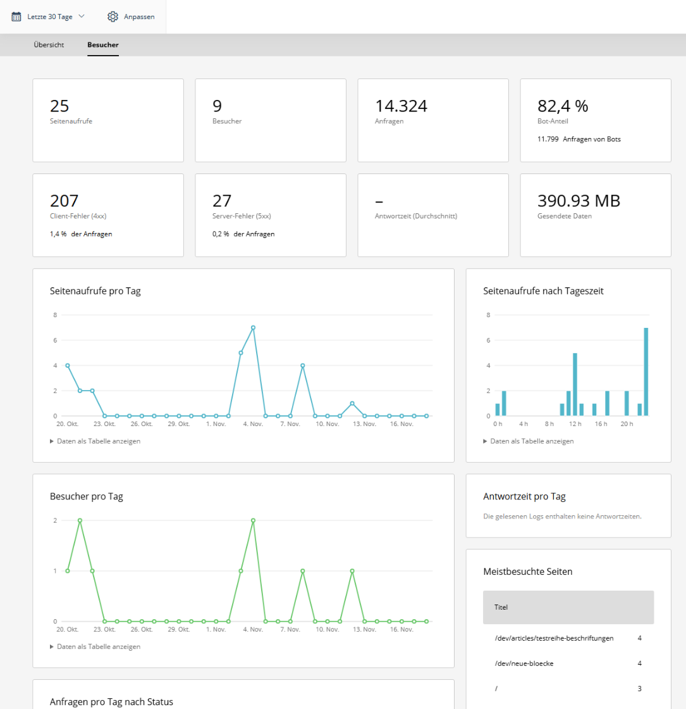

# Tabs: eine ganze Seite als Tab des Dashboards

Ein Bundle kann eine ganze Seite (nicht nur eine Kachel) aufs Dashboard bringen. Mit mindestens einem Tab wird das Dashboard zur Tab-View, wie Sulu sie für Personen und Organisationen nutzt: Der Tab „Übersicht“ zeigt die Kacheln, jeder Anbieter ergänzt einen Tab. Ohne Anbieter (oder wenn der Benutzer keinen sehen darf) gibt es keine Tab-Leiste, das Dashboard ist eine einzelne View.

```php
use Manuxi\SuluDashboardBundle\Tab\DashboardTabProviderInterface;

final class VisitorsTab implements DashboardTabProviderInterface
{
    public function getKey(): string { return 'visitors'; }                 // Teil des Pfads
    public function getTitle(): string { return 'app.visitors'; }           // Übersetzungsschlüssel oder Text
    public function getViewType(): string { return 'app.visitors_view'; }   // Schlüssel in Sulus viewRegistry
    public function getViewOptions(): array { return ['apiUrl' => '/admin/api/visitors']; }
    public function getSecurityContext(): ?string { return 'sulu.app.visitors'; }
    public function getPriority(): int { return 0; }                        // höher zuerst, nach „Übersicht“
}
```

- Die View ist wie üblich eine React-View, die in Sulus `viewRegistry` angemeldet wird (`viewRegistry.add('app.visitors_view', Visitors)`). Ihre Optionen liest sie aus `router.route.options`.
- Mit `autoconfigure: true` wird der Service automatisch gefunden (Tag `sulu_dashboard.tab`). Ein Bundle, das dieses Bundle nur vorschlägt (`suggest`), lädt den Service wie eine Kachel: mit `ContainerBuilder::willBeAvailable()` (siehe [Eigene Kachel in 5 Minuten](widgets.de.md)).
- Der Benutzer sieht den Tab nur mit dem Recht „Ansehen“ für `getSecurityContext()`.
- Schlüssel müssen eindeutig sein; `overview`, `dashboard` und `tabs` sind reserviert.

## Pfade

Sulu setzt den Pfad des Elternteils vor den Pfad eines Kindes. Das Dashboard übernimmt das für Sie:

| `start_page` | Tab-View | Übersicht | Tab `visitors` |
|---|---|---|---|
| `true` (Standard) | `/` | `/overview` | `/visitors` |
| `false` | `/dashboard` | `/dashboard/overview` | `/dashboard/visitors` |

Wer `/` öffnet, landet auf „Übersicht“. Sulus Suche bleibt auf `/search`. Vorhandene Direktlinks eines Bundles mit eigener Seite (zum Beispiel `/log-stats`) bleiben gültig, auch dessen Menüpunkt bleibt.

## Eingebaut: Besucher aus der Log-Statistik



Ist `amoifr/sulu-log-stats-bundle` installiert und aktiviert und hat der Benutzer das Recht `sulu.settings.log_stats`, bekommt das Dashboard den Tab **Besucher** (die Statistik-Seite dieses Bundles mit seinen Optionen `apiUrl` und `timezone`) und die Kachel **Besucher (7 Tage)** in der schmalen Spalte: Seitenaufrufe der letzten sieben Tage, die Summe der täglichen Besucher und der Anteil der Fehlerseiten (Status 4xx und 5xx). Die Log-Statistik ist keine Voraussetzung dieses Bundles (nur `suggest`); ohne sie wird nichts davon geladen.
