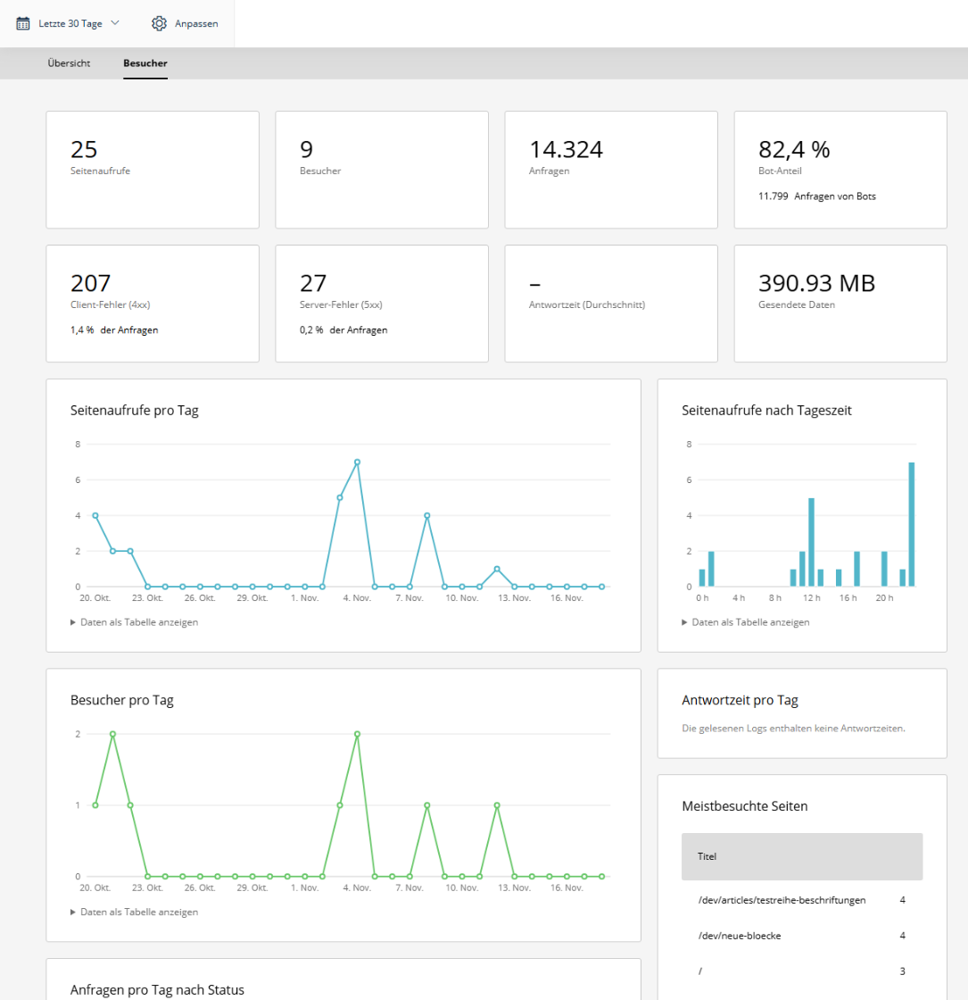

# Tabs: a whole page as a tab of the dashboard

A bundle can bring a whole page (not only a tile) to the dashboard. With at least one tab, the dashboard becomes a tab view like the ones Sulu uses for people and organizations: the tab "Overview" shows the tiles, every provider adds one tab. Without a provider (or if the user may see none), there is no tab bar and the dashboard is a single view.

```php
use Manuxi\SuluDashboardBundle\Tab\DashboardTabProviderInterface;

final class VisitorsTab implements DashboardTabProviderInterface
{
    public function getKey(): string { return 'visitors'; }                 // part of the path
    public function getTitle(): string { return 'app.visitors'; }           // translation key or text
    public function getViewType(): string { return 'app.visitors_view'; }   // key in Sulu's viewRegistry
    public function getViewOptions(): array { return ['apiUrl' => '/admin/api/visitors']; }
    public function getSecurityContext(): ?string { return 'sulu.app.visitors'; }
    public function getPriority(): int { return 0; }                        // higher first, after "Overview"
}
```

- The view is a React view you register in Sulu's `viewRegistry` as usual (`viewRegistry.add('app.visitors_view', Visitors)`). It reads its options from `router.route.options`.
- With `autoconfigure: true` the service is found automatically (tag `sulu_dashboard.tab`). A bundle that only suggests this bundle loads the service the same way as a tile: with `ContainerBuilder::willBeAvailable()` (see [Your own tile in 5 minutes](widgets.en.md)).
- The user sees the tab only with the view permission of `getSecurityContext()`.
- Keys must be unique; `overview`, `dashboard` and `tabs` are reserved.

## A tab of tiles

Instead of a view of its own, a tab can show tiles. They are arranged with the same "Customize" mode as the overview (see [Customize the dashboard](customize.en.md)), and every tab saves its arrangement for itself.

1. Give the tiles a group: implement `GroupedDashboardWidgetInterface` (extends the tile interface, one method `getGroup()`). A tile with a group appears only in the tab of that group; the overview shows only tiles without a group.
2. Implement `TilesTabProviderInterface` (extends the tab interface) for the tab:

```php
use Manuxi\SuluDashboardBundle\Admin\DashboardAdmin;
use Manuxi\SuluDashboardBundle\Tab\TilesTabProviderInterface;

final class VisitorsTab implements TilesTabProviderInterface
{
    // key, title, security context and priority as for any tab ...
    public function getViewType(): string { return DashboardAdmin::VIEW; } // ignored, the dashboard sets it
    public function getViewOptions(): array { return []; }                 // optional extra options

    public function getGroup(): string { return 'visitors'; }              // the tiles of this group
    public function getPeriods(): array { return [7, 30, 90, 365]; }       // [] = no period
    public function getDefaultPeriod(): int { return 30; }
    public function showLocale(): bool { return false; }                   // language select in the toolbar
}
```

The dashboard builds the view from it: type `sulu_dashboard.dashboard`, the tiles of the group, the setting key `sulu_dashboard.layout.<group>` for the arrangement, and the options below. Options you return from `getViewOptions()` win.

### Period

With periods, the toolbar of the tab gets a select ("Last 7 days" ... and "Custom period ..."). A custom period opens a bar above the tiles with two date pickers (from, to) and "Apply". A start day after the end day, a missing day or more than 366 days (the limit of the log statistics API) show an error in the bar and change nothing.

- The choice is saved per tab as a user setting (`sulu_dashboard.layout.<group>.period`) at once, so it is there after a reload.
- Every tile of the tab gets the prop `period`: `{days: 30}` (the last days up to today) or `{from: '2026-10-01', to: '2026-10-31'}` (days as `YYYY-MM-DD`, both included). The dashboard mounts the tiles again when the period changes; a tile that keeps its data in `props.cache` must include the period in the key.
- Without `getPeriods()` there is no select and `period` is not set. The overview has no period.

### Language select

`showLocale(): false` hides the language select of the tab, for tiles whose figures do not depend on the language.

## Replacing a menu item

A tab that brings a page which already has a menu item of its own can take its place, so the menu has one entry less. Implement `ReplacesNavigationItemInterface` (extends the tab interface):

```php
public function getReplacedNavigationItem(): string { return 'other_bundle.statistics'; } // name of its NavigationItem
public function getReplacedViews(): array { return ['other_bundle.dashboard']; }          // its views
```

The dashboard runs after all other admin classes and removes the menu item when the tab is visible to the user. The views of the replaced item stay as they are, so deep links keep working, and the menu item "Dashboard" is highlighted in them. Only top-level menu items can be replaced. Switch it off with `sulu_dashboard.tabs.replace_navigation: false`; the menu item then stays.

## Paths

Sulu puts the path of the parent in front of the path of a child. The dashboard handles this for you:

| `start_page` | tab view | Overview | tab `visitors` |
|---|---|---|---|
| `true` (default) | `/` | `/overview` | `/visitors` |
| `false` | `/dashboard` | `/dashboard/overview` | `/dashboard/visitors` |

Opening `/` redirects to "Overview". The search of Sulu stays on `/search`. Existing deep links of a bundle that brings its own page (for example `/log-stats`) stay valid.

## Built-in: visitors from the log statistics



*The screenshot shows the German admin.*

If `amoifr/sulu-log-stats-bundle` (version `~0.1`) is installed and enabled, and the user has the permission `sulu.settings.log_stats`, the dashboard gets the tab **Visitors** and the tile **Visitors (7 days)** in the narrow column (page views of the last seven days, the sum of the daily visitors and the share of error pages with status 4xx and 5xx). The tab replaces the menu item "Statistics" of that bundle (see above). The log statistics are not a requirement of this bundle (`suggest` only); nothing of it is loaded without it.

### The tab made of tiles (default)

The tab is a tab of tiles (see above, group `visitors`), with a period (7, 30, 90, 365 days or "Custom period ...") and the "Customize" mode: drag tiles, hide them, reset, saved separately from the overview.

| Area | Tiles |
|---|---|
| Row | Page views, visitors, requests, bot share, client errors (4xx), server errors (5xx), response time (with the 95th percentile), data sent |
| Charts | Page views per day, visitors per day, requests per day by status (stacked), page views by time of day, response time per day |
| Lists | Most visited pages, most frequent 404 errors, pages with server errors |
| Table | Figures per day |

Visitors are counted per day and added up: someone who comes back on another day counts again. All tiles share one request to `GET /admin/api/log-stats` per period. The charts are drawn by the display type `chart` of this bundle (see [Your own tile in 5 minutes](widgets.en.md)).

The page of the log statistics bundle itself is replaced: besides the menu item its view (`amoifr_log_stats.dashboard`) goes, and a request to its path (`#/log-stats`) is redirected to the tab "Visitors". This happens only together with the replaced menu item (`sulu_dashboard.tabs.replace_navigation: true`, the default).

```yaml
sulu_dashboard:
    log_stats:
        tab: tiles   # tiles (default): tab made of tiles. view: the page of the other bundle unchanged (technical fallback, no customizing)
```

### If the interface changes

The log statistics bundle is a 0.x bundle; the tiles read only its JSON (`totals`, `days`, `pageViewsByHourOfDay`, `topPages`, `topNotFound`, `topServerErrors`, `responseTime`). Missing fields count as empty, but never silently: a tile that lacks expected fields shows "The log statistics return other data than expected. Missing: ..." with the names of the fields. The expected shape is kept in `tests/fixtures/log-stats-response.json` and checked with `node --test tests/js/*.test.mjs`. This bundle therefore suggests only the version `~0.1`; for a new major version, adapt the fixture and the test to the new answer first.

The visitor statistics come from the bundle [amoifr/sulu-log-stats-bundle](https://github.com/Amoifr/sulu-log-stats-bundle) by Amoifr. Thank you for such a lean bundle that keeps data to a minimum: it brings the import, the aggregation, the privacy concept (salted daily hashes, only counters) and the interface the tab builds on.
